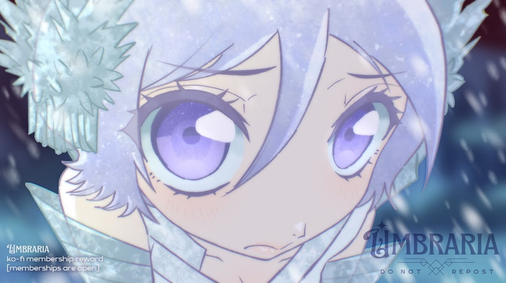

  

## привет, я Сазан

Меня все так зовут.

Увлекаюсь безопасностью в интернете и программированием. С детства к слову увлекаюсь этим. Определённого стека у меня нет: я изучаю безопасность в сети в целом. я прямо как lein , даа.. конечно..
Мой любимый язык - Go, а дальше планирую изучить C. ненавижу python за его скукоту. 

Ещё мне нравится VR, особенно PC VR. Играть в него пока не на чем, но ладно. имеется Quest 3 с Root , поэтому с ним мне скучно не бывает.

я еще в целом люблю аниме. но нет времени его смотреть . зато просмотрел весь блич. единственное аниме которое запомнилось мне по душе

### вот то что внизу , я может быть знаю, но не факт 

### проект который мне нравится и я буду его развивать

**[GoWave](https://github.com/aaaSaZaN/GoWave)** - мне начало становиться плохо от NodeJS , ненужного мне Redis и PostgreSQL в Remnawave поэтому я просто склонировал репо и переписал его на Go . имеет как и SQLite , так и маленький жор памяти . ну есть еще и [remnanode-go](https://github.com/aaaSaZaN/remnanode-go) которая совместима с remnawave . 
